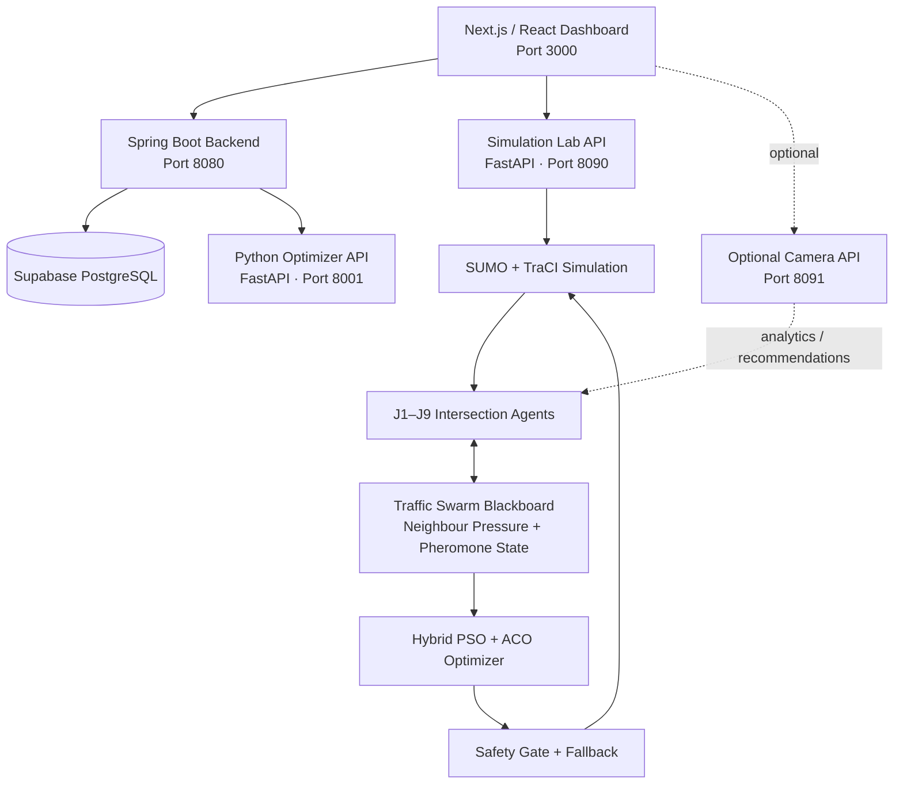
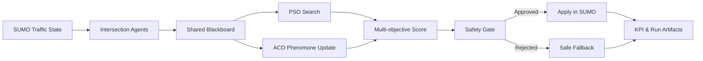

TRAFFIC SWARM INTELLIGENCE
Simulation-First Multi-Agent Traffic Signal Optimization
A research-oriented platform for coordinated traffic-signal optimization using swarm intelligence and SUMO simulation.

Designed & Developed by MATLUM
B.Tech Computer Science & Engineering — Final-Year Project

Overview
Traffic Swarm Intelligence (TSI) is a simulation-first research project that explores how multiple connected traffic intersections can coordinate their signal decisions using swarm-intelligence techniques.

The reference network models a 3 × 3 grid of nine signalized intersections (J1–J9). Each intersection acts as an agent, observes local traffic conditions, exchanges information with its direct neighbours through a shared Traffic Swarm Blackboard, and contributes to a coordinated signal-optimization process.

The optimization engine combines Particle Swarm Optimization (PSO) and Ant Colony Optimization (ACO). Candidate signal plans are evaluated against traffic objectives and must pass safety validation before they are applied to the SUMO simulation.

The platform brings together:
- SUMO + TraCI for microscopic traffic simulation and traffic-state collection.
- Python / FastAPI for the optimizer and Simulation Lab services.
- Java 21 / Spring Boot for experiment orchestration and backend APIs.
- Next.js / React for the web dashboard.
- PostgreSQL on Supabase for configured application and experiment data.
Project boundary: TSI is a research and simulation platform. It is not a certified traffic-management system and does not send commands to real-world traffic-signal hardware.

Table of Contents
- Key Features
- System Architecture
- Optimization Workflow
- Project Modules
- Technology Stack
- Repository Structure
- Getting Started
- Running the Application
- Running Experiments
- Network Presets
- Dashboard Modules
- Live Camera Service
- Testing and Release Verification
- Research Scope & Limitations
- Security and Configuration
- Documentation
- Third-Party Notices
- Ownership & Usage
Key Features
Capability	Description
Multi-agent intersections	Models the reference 3 × 3 network as nine cooperating agents, J1–J9.
Hybrid PSO + ACO	Combines particle velocity, personal/global best tracking, pheromone reinforcement and evaporation.
Shared swarm blackboard	Shares observations, neighbour pressure and digital pheromone state between connected agents.
Neighbour-aware coordination	Agents use local observations and direct-neighbour information rather than relying on all-to-all communication.
Safety gate	Validates candidate signal plans and applies conservative fallback behaviour when required.
Multi-objective evaluation	Includes queue, delay, stops, throughput, emissions and safety-oriented scoring utilities.
Baseline comparison	Compares swarm controllers against a fixed-time baseline using reproducible simulation inputs.
Experiment reproducibility	Supports scenarios, fixed seeds, run artifacts, comparison JSON, aggregation and validation.
Configurable networks	Supports legacy and generated grid presets, including larger networks.
OpenStreetMap workflow	Imports mapped road geometry and traffic-signal locations for selected simulation areas.
Live Digital City	Visualizes recorded SUMO simulation frames, vehicles, signals, congestion and agent events.
Optional camera pipeline	Provides a separate service for video ingestion, detection, tracking and traffic analytics.

System Architecture

Service responsibilities
Service	Main responsibility	Default port
Next.js dashboard	User interface, maps, visualization, admin and experiment views	3000
Optimizer API	Exposes the Python swarm-optimization functionality	8001
Spring Boot backend	Backend API, experiment orchestration and PostgreSQL integration	8080
Simulation Lab API	Starts and manages SUMO jobs; provides health, options, frames and run data	8090
Camera API (optional)	Independent video-processing and traffic-analytics service	8091

Each service runs as a separate process. Starting the dashboard alone does not start the optimizer, backend, Lab API or SUMO simulation.
Optimization Workflow
1. Traffic observation — SUMO and TraCI provide lane, queue, occupancy and signal-state observations.
2. Agent state update — each intersection agent processes its local traffic state.
3. Neighbour exchange — agents publish observations to the shared blackboard and read fresh information from direct neighbours.
4. Candidate generation — the hybrid PSO + ACO engine explores candidate signal decisions using particle and pheromone state.
5. Multi-objective scoring — candidate plans are evaluated using configured traffic objectives.
6. Safety validation — the safety gate checks a proposed plan before it is applied.
7. Simulation execution — validated decisions are applied inside SUMO through TraCI.
8. Measurement — run artifacts and KPIs are collected for baseline comparison and later analysis.

Project Modules
Module	Responsibility
SUMO Network	Legacy and generated road networks, junction topology, traffic lights and demand generation.
Traffic State Collection	TraCI-based simulation state and telemetry collection.
Fixed-Time Baseline	Reference controller used for controlled comparisons.
Hybrid PSO + ACO	Signal-plan search using particle and pheromone-based mechanisms.
Traffic Swarm Blackboard	Shared agent observations, neighbour status and pheromone information.
Multi-Agent Coordination	Junction topology, neighbour-aware decisions and coordinated green constraints.
Multi-Objective Scoring	Queue, delay, stops, throughput, emissions and safety-oriented utility helpers.
Routing & Risk	Optional pheromone/risk-aware route-choice components.
Safety Validation	Signal-plan checks, safety auditing and conservative fallback behaviour.
Experiment Engine	Scenario execution, seed control, raw artifacts, comparisons and aggregation.
Simulation Lab	Job lifecycle, simulation controls, recorded frames and run exploration.
Admin Panel	Controls the availability of configured dashboard modules and sections.
Live Camera	Separate optional pipeline for video detection, tracking and traffic analytics.

Development phases
The project is organized around these ten implementation areas:
1. Foundation and service contracts.
2. SUMO network and traffic-state collection.
3. Fixed-time baseline and KPI measurement.
4. Hybrid PSO + ACO optimization.
5. Traffic Swarm Blackboard.
6. Multi-agent coordination.
7. Multi-objective optimization.
8. Routing and proactive safety.
9. Dashboard and experiment-history interface.
10. Reproducible experiments, aggregation and validation.
Technology Stack
Layer	Technology
Traffic simulation	Eclipse SUMO and TraCI
Optimization services	Python, FastAPI, Uvicorn, Pydantic
Backend	Java 21, Spring Boot 3.5.5, Maven Wrapper
Frontend	Next.js 16, React 19
Database	PostgreSQL hosted on Supabase
Mapping	OpenStreetMap, Overpass, Leaflet and CesiumJS
Camera processing (optional)	OpenCV, PyTorch, Ultralytics/YOLO, ByteTrack integrations
Testing	pytest, Node.js test runner, Spring Boot tests
Deployment assets	Docker Compose and optional Frigate / go2rtc configuration

Repository Structure
traffic-swarm-main/
├── backend/                 # Java / Spring Boot API and PostgreSQL integration
├── camera_service/          # Optional video and traffic-analytics API
├── db/
│   └── migrations/          # Supabase SQL migrations
├── deploy/
│   └── live-camera/         # Frigate / go2rtc deployment examples
├── docs/                    # Research, implementation and deployment documents
├── experiments/
│   ├── lab/                 # Simulation Lab API and job management
│   ├── tools/               # Experiment runners, evaluation and validation
│   └── reports/             # Generated evaluation reports (when created)
├── frontend/                # Next.js / React dashboard
├── optimizer/               # Python FastAPI optimizer and swarm engine
├── simulation/              # SUMO networks, scenarios, controllers and runtime
├── tools/                   # Runtime preflight and project checks
├── FINAL_RELEASE_STATUS.md  # Release scope and verification boundary
├── THIRD_PARTY_NOTICES.md   # External software and data notices
├── requirements.txt         # Root Python dependencies
└── README.md
Getting Started
Prerequisites
Install the following tools before running the full system:
- Python 3.12 (recommended for the documented simulation environment).
- SUMO 1.27.1 with sumo, netconvert and compatible TraCI tools.
- JDK 21.
- Node.js and npm compatible with the frontend package configuration.
- Git.
- A Supabase PostgreSQL project for database-backed features.
- Docker only for workflows that use the supplied container configuration.
The backend includes a Maven Wrapper, so a separate global Maven installation is not normally required.

1. Clone the repository
git clone https://github.com/matlum2005/Swarm-intelligence.git
cd Swarm-intelligence
Open the project in Visual Studio Code:
code .
If you downloaded a ZIP instead, extract it and open the extracted repository root in VS Code.
2. Create a Python virtual environment
Run these commands from the repository root.

Windows PowerShell:
py -3.12 -m venv .venv
Set-ExecutionPolicy -Scope Process -ExecutionPolicy Bypass
.\.venv\Scripts\Activate.ps1
python -m pip install --upgrade pip
Install the simulation and optimizer dependencies:
pip install -r simulation/requirements.txt
pip install -r optimizer/requirements.txt
pip install numpy scipy matplotlib
The simulation requirements pin SUMO and TraCI to the documented compatible version. If SUMO is already installed system-wide, ensure that the installed TraCI version matches it.
3. Configure Supabase PostgreSQL
The Spring Boot backend connects to PostgreSQL using JDBC. Configure the database connection through environment variables; obtain the current connection details from your Supabase project dashboard.

Windows PowerShell:
$env:DB_URL = "jdbc:postgresql://YOUR_POOLER_HOST:5432/postgres?sslmode=require"
$env:DB_USER = "YOUR_DATABASE_USER"
$env:DB_PASSWORD = "YOUR_DATABASE_PASSWORD"
Replace the placeholders with your own Supabase values. Do not put real credentials in README files, source code, screenshots or Git commits.

For frontend/admin features, use the environment-variable names documented in .env.example and docs/ADMIN_PANEL_DEPLOYMENT.md. For local Next.js development, place the relevant variables in frontend/.env.local. Never expose Supabase service-role or secret keys through variables prefixed with NEXT_PUBLIC_.
4. Apply database migrations
In the Supabase Dashboard, open SQL Editor and apply the required files from db/migrations/ in the order documented by docs/ADMIN_PANEL_DEPLOYMENT.md.

The Live Camera migration is optional and should only be applied when that module is being configured. Review migrations and back up important data before applying changes to a production database.
Running the Application
Start each service in its own VS Code terminal. Keep the terminal open while the service is in use.
A. Optimizer API — port 8001
From the repository root:
cd optimizer
python -m uvicorn app.main:app --reload --host 127.0.0.1 --port 8001
API documentation: http://127.0.0.1:8001/docs
B. Simulation Lab API — port 8090
Open a new terminal and return to the repository root. Activate the Python virtual environment if needed, then run:
python -m uvicorn experiments.lab.api:app --host 127.0.0.1 --port 8090
Health endpoint: http://127.0.0.1:8090/api/lab/health
API documentation: http://127.0.0.1:8090/docs
Important: Run this command from the repository root. The experiments package is not inside the optimizer directory.

C. Spring Boot backend — port 8080
Open a new terminal. Set DB_URL, DB_USER and DB_PASSWORD in that terminal, then run:
cd backend
.\mvnw.cmd spring-boot:run
Health endpoint, when enabled: http://127.0.0.1:8080/actuator/health
D. Next.js frontend — port 3000
Open a new terminal:
cd frontend
npm install
npm run dev
Open the dashboard at http://localhost:3000.
E. Optional Live Camera API — port 8091
Only start this service when setting up the Live Camera module. From the repository root, with the appropriate Python environment active:
pip install -r camera_service/requirements.txt
python -m uvicorn camera_service.api:app --host 127.0.0.1 --port 8091
The camera service has additional model, video-source and secret configuration. Read the Live Camera section and THIRD_PARTY_NOTICES.md before enabling it.
Local service checklist
Terminal	Service	Port
1	Optimizer API	8001
2	Simulation Lab API	8090
3	Spring Boot backend	8080
4	Next.js dashboard	3000
5 (optional)	Live Camera API	8091

Running Experiments
Run a single experiment from the repository root:
python experiments/tools/run_experiment.py --scenario normal --seed 42 --root .
Run the experiment matrix:
python experiments/tools/run_matrix.py --root .
Run the staged evaluation matrix:
python -m experiments.tools.evaluate_matrix run --stage core --workers 4
Check evaluation progress:
python -m experiments.tools.evaluate_matrix status
Generate the analysis report:
python -m experiments.tools.analyze_evaluation
Supported evaluation stages include core, ablation, emergency and mixed. Reports are written under experiments/reports/. Treat results as preliminary until all planned cells are complete and their run artifacts pass validation.
Runtime preflight
From the repository root:
python tools/runtime_preflight.py
This checks whether key runtime tools such as Python, SUMO, netconvert, Maven, npm, Docker and TraCI are discoverable.
Network Presets
Network and controller settings are configured in simulation/config/networks.json.
Preset	Description
grid3x3_legacy	Original hand-authored J1–J9 network; retained for regression comparisons.
grid3x3	Generated 3 × 3 grid.
grid5x5	Generated 5 × 5 grid.
grid7x7	Generated 7 × 7 grid.
grid9x9	Generated 9 × 9 grid.
demo_city	Compact 3 × 4 demonstration grid with 12 signalized junctions.
grid5x5_india	Configured left-hand-traffic scenario with assumed Indian urban vehicle mix.
osm_*	OpenStreetMap-based scenario presets defined in the configuration.

Build and validate a generated network:
python -m simulation.network.build_network --preset grid9x9
Run an experiment on the generated network:
python experiments/tools/run_experiment.py --network grid9x9 --scenario normal --seed 42 --root .
SUMO runs headless by default. Add --gui or set TSI_SUMO_GUI=1 to request the SUMO graphical interface.
Dashboard Modules
The dashboard includes multiple research and visualization areas, including:
- Overview / Live Digital City — recorded SUMO frames, vehicles, signals, congestion levels and agent events.
- Before / After — controller comparison views.
- Controllers — controller evaluation and configuration views.
- Prediction — prediction-related dashboard module.
- Mixed Traffic — mixed-traffic scenario views.
- How It Works — explanation of the swarm workflow.
- 3D View — 3D visualization using CesiumJS.
- Signal Map — OpenStreetMap-based traffic-signal map.
- Live Camera — optional camera-processing interface.
- Admin — module and section visibility controls.
OpenStreetMap and real-world areas
The Signal Map and Live Lab can use OpenStreetMap road geometry and mapped traffic-signal locations. The Live Lab can create a SUMO network for a selected supported area.

Important data distinction: OpenStreetMap does not provide live traffic counts or real signal timings through this project. Vehicle queues, platoons, fuel use and other traffic measurements are generated by the SUMO demand model. They are simulation outputs, not live measurements from the road.

Map data © OpenStreetMap contributors and is made available under the Open Database License (ODbL) 1.0. Preserve the required attribution.
Live Camera Service
The optional /live-camera module runs as a separate service under camera_service/. Its pipeline includes video ingestion, object detection, tracking, traffic analytics, agent integration and safety validation.

Before enabling it:
1. Review camera_service/requirements.txt and the model/runtime requirements.
2. Apply db/migrations/005_live_camera_module.sql after the required earlier migrations.
3. Configure CAMERA_URL and the shared TSI_GATEWAY_SECRET where applicable.
4. Configure server-side Supabase access and TSI_CAMERA_SECRET_KEY as documented.
5. Review THIRD_PARTY_NOTICES.md, especially the Ultralytics licensing terms.
Operational boundaries:
- Webcam and USB sources are labelled TEST SOURCE; uploaded or file-backed sources are labelled REPLAY.
- A LIVE label is an administrator's declaration that a source is a real roadside camera.
- Video access and public previews are controlled by admin settings. Review permissions and retention before using real camera feeds.
- Without calibration, queue values are vehicle counts and speed values are pixel-based estimates. Calibrated metric values are still estimates.
- REAL CONTROLLER mode is refused. The project contains no code that sends commands to real traffic-signal hardware.
- Camera-driven recommendations are not proof of traffic improvement. The SUMO demand stream is not automatically generated from the camera feed.
Frigate and go2rtc deployment examples are available in deploy/live-camera/.
Testing and Release Verification
Run Python tests from the repository root:
python -m pytest -q
Run camera-service tests:
python -m pytest camera_service/tests
Run frontend tests and production build:
cd frontend
npm test
npm run build
Run backend tests:
cd backend
.\mvnw.cmd test
Verification record
According to FINAL_RELEASE_STATUS.md, the recorded build checks include:
- Python compilation — PASS
- Python unit / integration-style tests — 12/12 PASS
- Scenario generation and validation — 5/5 PASS
- Project integrity checks — PASS
The release record does not claim that every environment-dependent workflow was executed in the build environment. Actual SUMO runs, Maven builds, Docker workflows, database connectivity and the frontend production build must be verified on a machine with the required tools and configuration installed.
Research Scope & Limitations
- This repository is a simulation-first research prototype, not a production traffic-control product.
- Research-paper percentages are not project results. Report only measurements produced by completed experiments in this repository.
- A controller or module being implemented does not establish that it improves traffic performance.
- A documented first check found that swarm_hierarchical performed worse than swarm for the specific reported grid5x5 rush-hour seed-42 run. Treat hierarchical coordination as an experimental controller and evaluate it before making improvement claims.
- OSM road geometry and signal tags can be incomplete or outdated; generated SUMO signal timings are not verified real-world signal plans.
- Fuel and emissions estimates depend on the configured vehicle/emission model and should be interpreted within the documented experiment limits.
- Safety constraints take precedence over optimizer scores.
For methodology, metrics and statistical treatment, see docs/RESEARCH_METHODOLOGY.md.
Security and Configuration
- Keep database passwords, Supabase service-role keys, secret keys, admin credentials and gateway secrets out of source control.
- Use local environment files such as frontend/.env.local and ensure they are ignored by Git.
- Never expose privileged Supabase credentials through NEXT_PUBLIC_* variables.
- Rotate any credential that has previously been committed to a public repository or shared in an untrusted location. Removing it from the latest file does not remove it from Git history.
- Restrict the Lab API and camera service to trusted callers; configure TSI_GATEWAY_SECRET consistently where required.
- For real camera sources, obtain required permissions, minimize collection, restrict access and configure retention deliberately.
Documentation
Document	Description
[`FINAL_RELEASE_STATUS.md`](FINAL_RELEASE_STATUS.md)	Included functionality and release verification boundary.
[`docs/IMPLEMENTATION_STATUS.md`](docs/IMPLEMENTATION_STATUS.md)	Implementation details, measured checks and known limitations.
[`docs/INTEGRATION_STATUS.md`](docs/INTEGRATION_STATUS.md)	Integration status across project services.
[`docs/RESEARCH_METHODOLOGY.md`](docs/RESEARCH_METHODOLOGY.md)	Experiment methodology, metrics and statistical approach.
[`docs/ADMIN_PANEL_DEPLOYMENT.md`](docs/ADMIN_PANEL_DEPLOYMENT.md)	Admin configuration, environment variables and deployment steps.
[`docs/MASTER_UPGRADE_PLAN.md`](docs/MASTER_UPGRADE_PLAN.md)	Project upgrade planning reference.
[`THIRD_PARTY_NOTICES.md`](THIRD_PARTY_NOTICES.md)	Third-party software, map data and license notices.

Third-Party Notices
This project integrates or references third-party software, services, map data and assets. Their respective licenses and attribution requirements continue to apply. Review [`THIRD_PARTY_NOTICES.md`](THIRD_PARTY_NOTICES.md) before redistribution or deployment.

In particular, the notices document OpenStreetMap data attribution, CesiumJS licensing and the licensing implications of optional camera components such as Ultralytics. Project ownership does not transfer ownership of third-party components.
Ownership & Usage
Project: Traffic Swarm Intelligence
Project maintainer: Matlum
Copyright: © 2026 Matlum. All rights reserved for original project-specific materials.

The original source code, project-specific documentation, architecture descriptions and other original materials created for this project are proprietary to Matlum, except where a component is identified as third-party material.

No permission is granted to copy, modify, redistribute, publish, sublicense, sell or commercially exploit those original proprietary materials without prior written permission from Matlum. Third-party packages, libraries, datasets, map data, models and assets remain governed by their own licenses and terms.

Repository visibility matters: this notice communicates the intended usage policy, but it does not technically prevent cloning of a public GitHub repository. To restrict access to the source, set the GitHub repository visibility to Private and review collaborator permissions.

Built with research, simulation and swarm intelligence.
TRAFFIC SWARM INTELLIGENCE
Designed & Developed by MATLUM

© 2026 Matlum · All Rights Reserved for original project materials

